<div align="center">


# ModelPass

**用你自己的模型，登录任何应用。**

移动端的「CC Switch」 + 一套「使用 ModelPass 继续」的开放授权协议（iOS / Android / Web）

[协议规范](docs/protocol.md) · [架构与安全](docs/architecture.md) · [接入指南](docs/integration.md) · [订阅授权可行性](docs/subscriptions.md)

</div>

---

ModelPass 是一个手机上的「模型钱包」。你把自己的 API Key（或可授权的厂商账户）放进 ModelPass，任何接入了协议的 App 都可以像「使用 Google 登录」一样一键获得你的授权：

- **应用里不用再填 API Key** —— 应用只拿到一个 OpenAI 兼容的 `api_base` 和一个可随时撤销的令牌，永远看不到你的 Key；
- **模型由你在钱包里决定** —— 应用请求的是「槽位」（默认 / 快速 / 推理 / 视觉），你在 ModelPass 里一键切换厂商和模型，所有应用即时生效；
- **每个应用单独管控** —— 权限范围、每日额度、有效期、暂停、撤销、用量记录。

<table>
<tr>
<td align="center">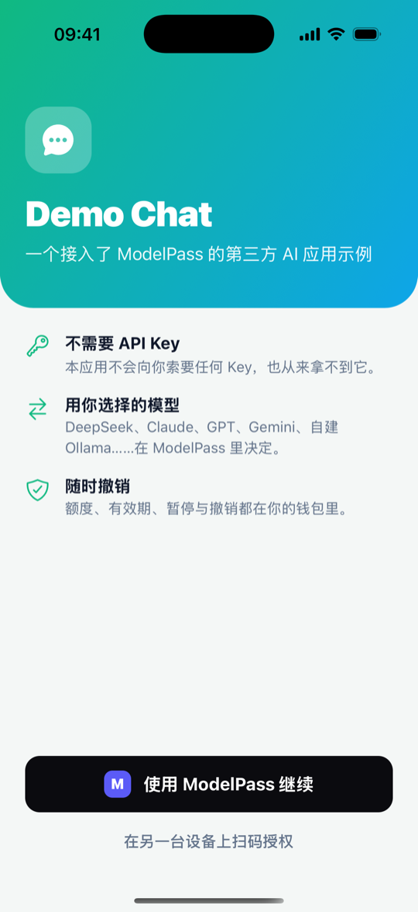<br/><sub>① 第三方应用：使用 ModelPass 继续</sub></td>
<td align="center">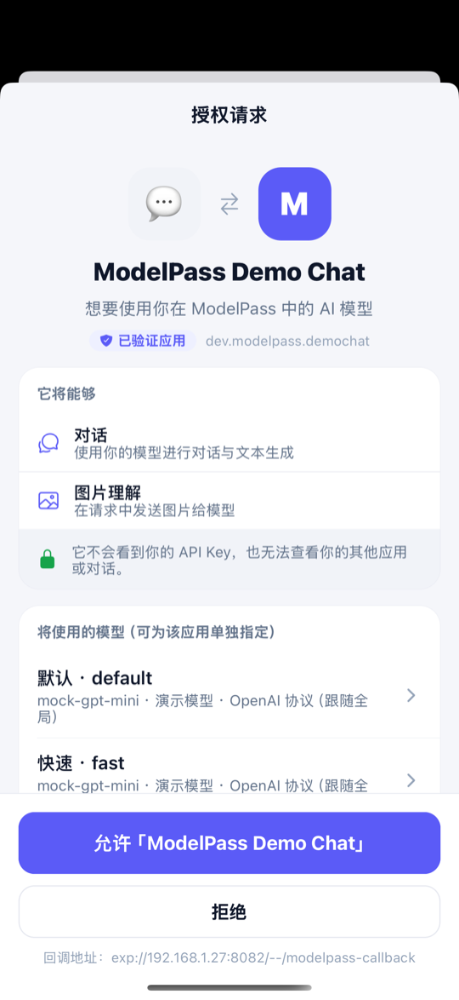<br/><sub>② 钱包授权页（PKCE）</sub></td>
<td align="center">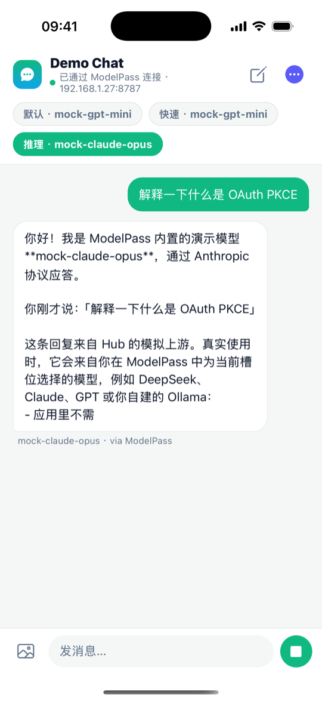<br/><sub>③ 应用直接开始对话（流式）</sub></td>
</tr>
<tr>
<td align="center">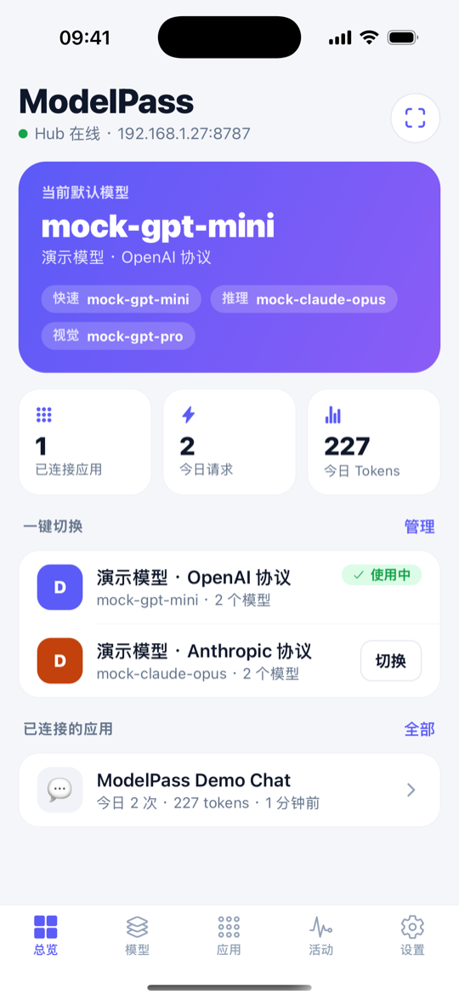<br/><sub>④ 钱包首页：一键切换</sub></td>
<td align="center">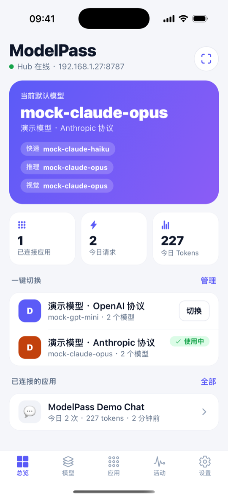<br/><sub>⑤ 切到另一个厂商</sub></td>
<td align="center">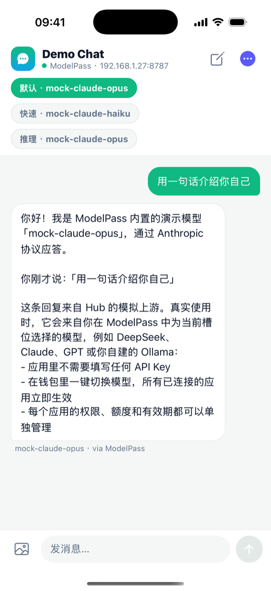<br/><sub>⑥ 应用无需改动，立即换模型</sub></td>
</tr>
<tr>
<td align="center">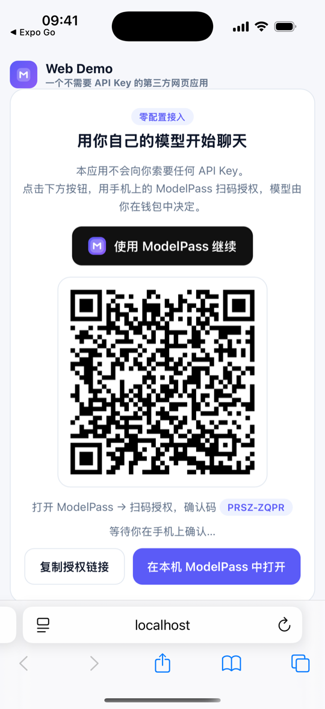<br/><sub>⑦ 网页应用：扫码授权</sub></td>
<td align="center">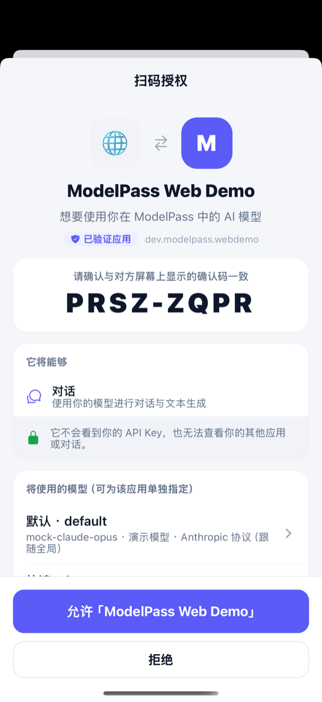<br/><sub>⑧ 钱包核对确认码</sub></td>
<td align="center">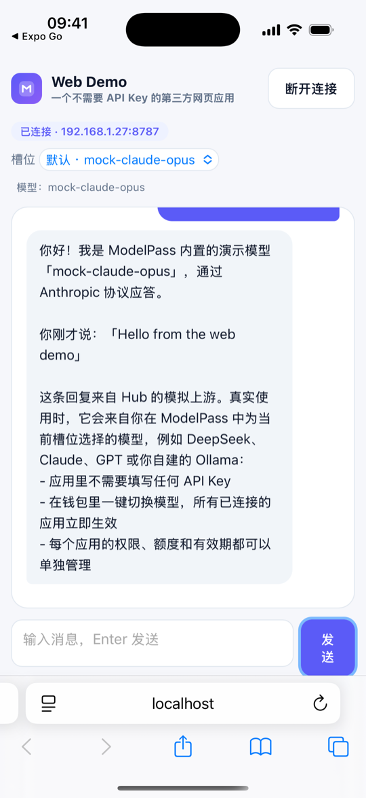<br/><sub>⑨ 令牌端到端加密送达网页</sub></td>
</tr>
</table>

<details>
<summary>更多截图（引导页、模型槽位、应用管理、活动记录、厂商配置）</summary>

<p>
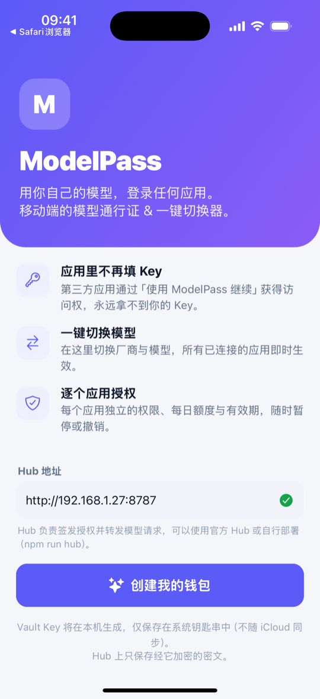
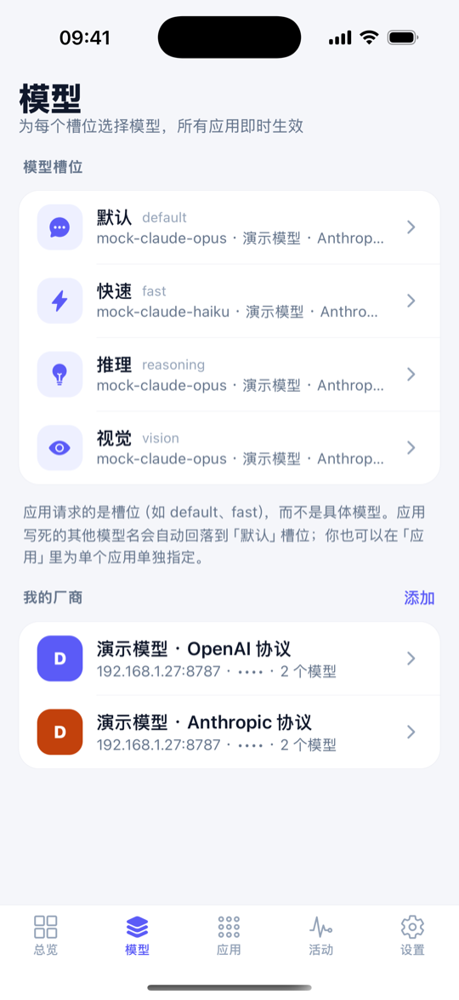
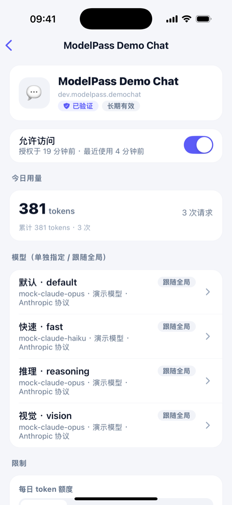
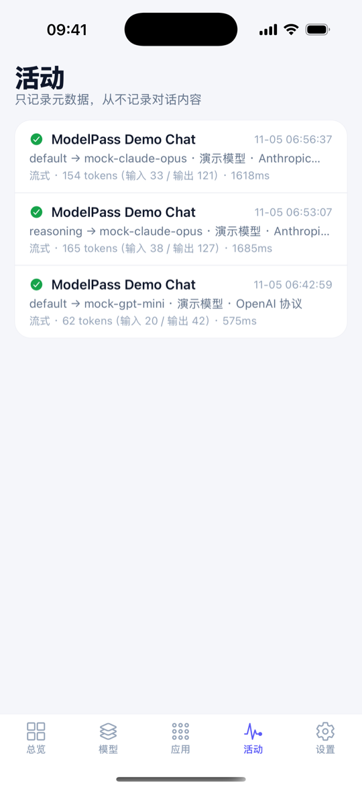
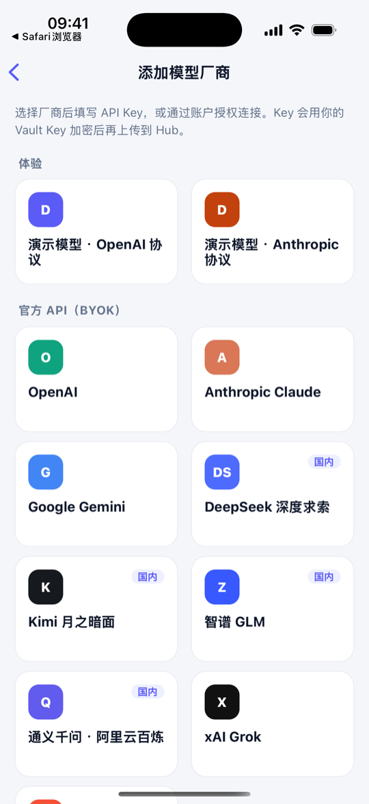
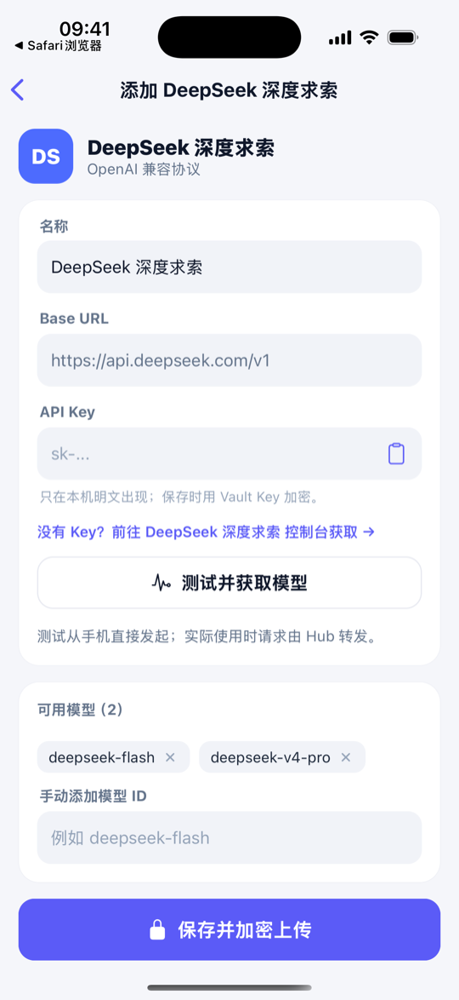
</p>
</details>

> 以上截图均来自本仓库代码在 iPhone 16 Pro 模拟器（iOS 18.3，Expo Go SDK 58）中的真实运行，模型为 Hub 内置的模拟上游。

## 工作原理

```
 第三方 App ──① modelpass://authorize (PKCE)──▶ ModelPass 钱包 ──封存的凭据 / 路由──▶ ModelPass Hub
     ▲                                              │                                  │
     └──────────② redirect_uri?code&iss─────────────┘                                  │
     ──③ POST {iss}/oauth/token ─▶ access_token + api_base ───────────────────────────▶│
     ──④ POST {api_base}/chat/completions (Bearer mpk_…) ─────────────────────────────▶│──▶ 你的厂商
```

- **协议**：同设备用 OAuth 2.0 授权码 + PKCE（钱包在回调里用 `iss` 告诉应用该去哪个 Hub 换令牌）；跨设备用扫码授权（RFC 8628 设备流 + 二维码中的一次性密钥，令牌端到端加密）。完整规范见 [docs/protocol.md](docs/protocol.md)。
- **Hub**：授权服务器 + 模型中继，OpenAI Chat Completions / Anthropic Messages 兼容，自动在 OpenAI ⇄ Anthropic ⇄ Responses 之间转换（含 SSE 流、工具调用、图片、thinking 块回放）。可以用官方 Hub，也可以自托管。
- **密钥封存**：手机生成的 Vault Key 只存在本机钥匙串；厂商 Key 以 VK 加密后才上传，访问令牌 = 解开 VK 的钥匙。**Hub 数据库泄露拿不到任何 Key；偷走钱包会话也签发不了可用的授权。** 详见 [docs/architecture.md](docs/architecture.md)。

## 能授权「厂商订阅」吗？

| 订阅 | 结论 |
| --- | --- |
| ChatGPT Plus / Pro / Go | ✅ OpenAI 官方「Sign in with ChatGPT」套餐额度（需注册）→ 实验性连接器 |
| OpenRouter 账户 | ✅ 官方 OAuth PKCE → 已支持「账户授权」 |
| Hugging Face PRO | ✅ 官方 OAuth（`inference-api`）→ 规划中 |
| Claude Pro / Max | ❌ Anthropic 明确禁止在第三方产品中使用订阅令牌 |
| Gemini / Google AI 订阅 | ❌ 没有官方授权途径 |
| 国内各家 Coding Plan | ❌ 仅限官方支持的编程工具 |

依据与出处见 [docs/subscriptions.md](docs/subscriptions.md)。

## 快速开始（5 分钟，无需任何真实 Key）

需要 Node.js 22.13+（推荐 24），以及装有 [Expo Go](https://expo.dev/go)（SDK 58）的手机或 iOS 模拟器。

```bash
git clone https://github.com/yanboishere/model-pass && cd model-pass
npm install

npm run hub        # ① Hub：http://localhost:8787（内置模拟上游 + 网页 Demo）
npm run wallet     # ② 钱包 App（Metro 端口 8081）：Expo Go 扫码，或按 i 打开 iOS 模拟器
```

在钱包里点「创建我的钱包」（会自动识别同一局域网的 Hub）→「体验演示模型」。然后启动第三方示例应用：

```bash
# ③ 两个应用都运行在 Expo Go 里时，钱包入口是它的 Expo Go 地址；独立构建时使用默认的 modelpass://authorize
EXPO_PUBLIC_MODELPASS_WALLET_URL=exp://<你的局域网 IP>:8081/--/authorize npm run demo
```

在 Demo Chat 中点「使用 ModelPass 继续」→ 在钱包里允许 → 回到 Demo Chat 开始对话。之后在钱包里切换模型，Demo Chat 立即生效。

**Android 安装包**：在 [Releases](https://github.com/yanboishere/model-pass/releases) 下载 `ModelPass-Wallet` 与 `ModelPass-DemoChat` 两个 APK（由 `.github/workflows/android-release.yml` 自动构建），装好后在钱包里填写 `http://<电脑局域网 IP>:8787` 即可，不需要 Expo Go。

其他玩法：

- **网页扫码授权**：电脑浏览器打开 <http://localhost:8787/demo>，用钱包右上角的「扫码」扫描二维码。
- **命令行**：`npm run dev-token` 直接拿到一个令牌，然后用 `curl` / 任何 OpenAI SDK 调用。
- **真实模型**：在钱包「模型 → 添加」中选择 DeepSeek / OpenAI / Claude / Gemini / Kimi / 智谱 / 通义 / OpenRouter / Ollama 等，填入 Key 并「测试并获取模型」，再为各槽位选择模型。
- **接入你自己的 App**：见 [docs/integration.md](docs/integration.md)（React Native / iOS / Android / Web 示例）。

## 仓库结构

```
docs/                 协议规范、架构与安全模型、接入指南、订阅调研、跨语言测试向量
packages/core         协议核心（TypeScript）：类型、PKCE、封存、扫码密码学、路由、厂商预设、WalletClient
packages/sdk          JS / React Native 客户端 SDK（@modelpass/sdk）
hub/                  Hub：OAuth + 扫码汇合 + 钱包 API + 模型中继/协议转换 + 用量额度 + 模拟上游 + 网页 Demo
apps/wallet           ModelPass 钱包 App（Expo / React Native，iOS + Android）
apps/demo-chat        第三方示例应用（Expo / React Native）
sdks/ios              iOS Swift SDK（Swift Package，零依赖）
sdks/android          Android Kotlin SDK（纯 JVM 核心 + Android 库）
scripts/interop       跨语言互通测试：无头钱包 + Swift 测试程序
Package.swift         让 iOS 项目可以直接以 SwiftPM 依赖本仓库
```

## 测试与验证

| 范围 | 怎么验证的 | 结果 |
| --- | --- | --- |
| 协议核心 | `npm test`：16 项，含 RFC 7636（PKCE）、RFC 5869（HKDF）官方向量，测试向量与 Node 原生 crypto 交叉校验 | ✅ |
| Hub | 15 项端到端 + 4 项转换单测：同设备授权、码重放、PKCE、未注册回调、OpenAI/Anthropic/Responses 三种上游（流式/非流式/工具调用/thinking 回放）、OAuth 刷新与重新封存、scope、额度、暂停、单独路由、撤销、扫码流程、数据库不含明文 Key | ✅ |
| JS SDK | 回调 / state / issuer 校验单测，并在 Hub 端到端测试中作为客户端 | ✅ |
| iOS Swift SDK | `swift test` 81 项 + iOS 模拟器构建 + 对真实 Hub 的互通测试（同设备授权、流式、CJK 响应头、撤销、扫码） | ✅ |
| Android Kotlin SDK | JVM 单测 53 项 + 对真实 Hub 的 2 项互通测试；Android 库（AAR）由 CI 用 AGP 9.5 实际打包通过 | ✅ |
| 两个 App | 类型检查 + iOS / Android 的 Metro 打包；在 iOS 模拟器中实际跑通：引导、演示模型、跨应用授权、流式对话、一键切换、扫码授权（网页 WebCrypto 解密）、重置钱包会撤销所有授权 | ✅ |
| 未验证 | Android 真机 / 模拟器上运行（本机没有 Android SDK）；真实厂商 API（仅用模拟上游，但请求格式就是各家的标准 API）；ChatGPT 与 OpenRouter 账户授权的真实账户流程 | ⚠️ |

CI（`.github/workflows/ci.yml`、`ios.yml`）会跑以上全部自动化测试，包括 Swift / Kotlin 与真实 Hub 的互通测试和 Android AAR 打包。

## 路线图

- 钱包入口改用经域名验证的通用链接 / App Link，接入 App Attest / Play Integrity
- 多设备同步与 Vault Key 恢复
- 按金额计的额度；Embeddings、图像生成接口
- 更多官方厂商连接器（Hugging Face OAuth 等）
- Hub 的容器镜像与一键部署；探索 TEE（机密计算）中继

## English summary

**ModelPass** is a mobile "model wallet" plus an open authorization protocol: apps add a *Continue with ModelPass* button (OAuth 2.0 + PKCE between apps, or a QR-code device flow with end-to-end encrypted token delivery) and receive an OpenAI-compatible `api_base` plus a revocable token. They never see the user's API keys; users route abstract model *slots* (`default`, `fast`, `reasoning`, `vision`) to any provider and switch for all apps with one tap — a mobile take on CC Switch. Provider credentials are sealed under a vault key that never leaves the phone, so a hub database leak exposes no keys. The repo contains the spec, a self-hostable hub (Hono + SQLite, OpenAI ⇄ Anthropic ⇄ Responses translation), the Expo wallet and demo apps, and SDKs for JS/React Native, Swift and Kotlin, all tested against each other.

## License

[MIT](LICENSE)
