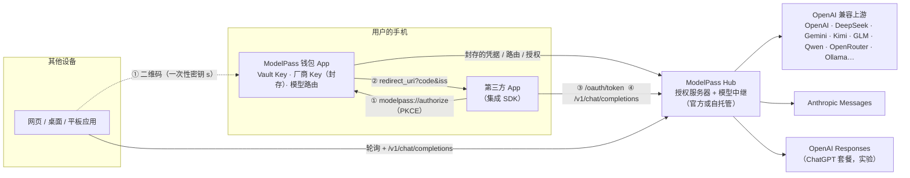

# 架构与安全模型

## 组件



| 组件 | 代码 | 职责 |
| --- | --- | --- |
| 协议核心 | `packages/core` | 协议类型、PKCE、封存（HKDF + AES-256-GCM）、扫码流程密码学、路由解析、厂商预设、钱包侧客户端 `WalletClient` |
| Hub | `hub/` | OAuth 端点、扫码汇合点、钱包私有 API、模型中继与协议转换、用量与额度、内置模拟上游、网页 Demo |
| 钱包 App | `apps/wallet` | 生成并保管 Vault Key、管理厂商与槽位路由（一键切换）、授权同意页、应用管理、活动记录 |
| 客户端 SDK | `packages/sdk`（JS/RN）、`sdks/ios`（Swift）、`sdks/android`（Kotlin） | 「使用 ModelPass 继续」、回调处理、扫码授权、对话（含 SSE 流式） |
| 示例应用 | `apps/demo-chat`、Hub 的 `/demo` | 没有任何 API Key 的第三方 App / 网页 |

## 各方保存了什么

| 数据 | 钱包（手机） | Hub | 第三方应用 |
| --- | --- | --- | --- |
| Vault Key（VK） | ✅ Keychain / Keystore（本机专属，不备份） | ❌ | ❌ |
| 厂商 Key / OAuth 令牌 | 用 VK 封存的密文（与 Hub 上相同） | 用 VK 封存的密文 | ❌ |
| 访问令牌 `mpk_…` | ❌（交出后即丢弃） | 只存 `SHA256(token)` 与 `wrap(VK, token)` | ✅ 明文（应存 Keychain/Keystore） |
| 路由、额度、授权元数据 | ✅ | ✅（明文） | 只能读取自己的授权信息 |
| 对话内容 | ❌ | ❌（只转发，不落盘） | ✅ |

## 一次请求发生了什么

1. 应用带着 `Authorization: Bearer mpk_<secret>` 调用 `/v1/chat/completions`；
2. Hub 用 `SHA256(token)` 找到授权，检查状态、有效期、scope、每日额度；
3. 用令牌中的 `secret` 解开 `wrapped_vk` → 得到 VK；
4. 按 [路由规则](./protocol.md#83-post-v1chatcompletions) 找到槽位对应的厂商 + 模型（单独指定 > 全局 > default）；
5. 用 VK 解开该厂商的封存凭据（`base_url` 与 Key 都在密文中，AAD 绑定用户与厂商 ID）；
6. 订阅类凭据（ChatGPT 套餐）若已过期，用刷新令牌换新并**用 VK 重新封存**写回；
7. 按上游格式转换请求（OpenAI Chat ⇄ Anthropic Messages / OpenAI Responses），转发并把响应（含 SSE 流）转换回 OpenAI 格式；
8. 记录用量元数据（时间、槽位、模型、token 数、耗时、状态码），请求结束后内存中的明文随之丢弃。

## 威胁模型

| 场景 | 结果 |
| --- | --- |
| Hub 数据库泄露 | 攻击者只得到密文、令牌哈希和被包裹的 VK，**拿不到任何厂商 Key**，也无法伪造可用的令牌 |
| 钱包与 Hub 之间的会话令牌被盗 | 可以查看 / 撤销授权（拒绝服务），但**签发不了能用的新授权**：创建授权需要用 VK 生成 `wrapped_vk`，VK 只在手机上 |
| 第三方应用的令牌泄露 | 影响限定在该授权：受 scope、槽位、每日额度、有效期约束，用户可在钱包中一键撤销 |
| 恶意应用抢注 `modelpass://` scheme 冒充钱包 | 它拿不到真实钱包的 Key，但可能返回指向恶意 Hub 的 `iss`。缓解：SDK 对 `iss` 做 https / 白名单校验并在 UI 展示 Hub；正式版钱包入口改用经域名验证的通用链接 |
| 恶意应用冒用别的应用的 `client_id` | 已注册应用的 `redirect_uri` 由 Hub 校验，授权码只会送达该应用声明的回调；未注册应用在授权页标注「未验证」。后续可接入 App Attest / Play Integrity |
| 授权码在跳转中被截获 | PKCE（S256）使其无法被兑换；授权码 120 秒内单次有效 |
| 扫码授权的汇合 Hub 是恶意的 | 令牌用二维码里的一次性密钥 `s` 端到端加密，Hub 只看到 `HMAC(s)` 的单向结果：既读不到令牌，也伪造不出客户端能解开的密文 |
| 二维码被偷拍 | 偷拍者可以抢先用自己的钱包完成授权（所有设备授权流程共有的风险）；客户端会显示连接到的 Hub，二维码 10 分钟过期 |
| Hub 运营方作恶 | 转发请求的那一刻 Hub 必须解密 Key，因此运营方需要被信任。不愿信任官方 Hub 的用户可以**自托管**；后续可探索 TEE（机密计算）中继 |
| 手机丢失 | VK 存在本机专属钥匙串中、受设备锁保护，拿到手机也需要解锁。Demo 尚无账户恢复：丢失后需要在 Hub 侧吊销旧账户的授权（自托管可直接操作），多设备与恢复在规划中 |

## 协议转换要点

- **OpenAI Chat → Anthropic Messages**：`system`/`developer` 合并为顶层 `system`；相邻同角色消息合并（Anthropic 要求交替）；`tool` 消息变为 `tool_result` 块；图片 `image_url`（data URL / https）变为 `image` 块；`stop` → `stop_sequences`；`reasoning_effort` → `output_config.effort`；默认 `max_tokens`：新模型流式 64000 / 非流式 16000。
- **新一代 Claude 的限制**：Opus 4.7+、Claude 5 系列会拒绝 `temperature/top_p`，Opus 5.5 / Sonnet 5.5 / Fable 5.1 拒绝强制 `tool_choice`。Hub 按模型名自动去掉采样参数、把 `required` 降级为 `auto`。
- **thinking 块回放**：Claude 在工具调用循环中要求原样回传上一轮的 thinking 块，而 OpenAI 格式没有地方放它。Hub 以「授权 + tool_use id」为键在内存中缓存（1 小时，LRU），在应用回传对应的 `tool_calls` 时自动补上。内置的模拟 Anthropic 上游会强制检查这一点，端到端测试覆盖了流式与非流式两种情况。
- **ChatGPT 套餐（Responses API）**：强制 `store:false`、`stream:true`，去掉 `temperature`/`max_output_tokens`；非流式请求由 Hub 聚合流事件后返回。

## 自托管 Hub

```bash
npm install
MODELPASS_PUBLIC_URL=https://hub.example.com npm run hub
```

| 环境变量 | 默认 | 说明 |
| --- | --- | --- |
| `PORT` / `HOST` | `8787` / `0.0.0.0` | 监听地址 |
| `MODELPASS_PUBLIC_URL` | 按请求 Host 推导 | 固定 issuer（生产环境必须设置，并通过反向代理提供 HTTPS） |
| `MODELPASS_DATA_DIR` | `hub/data` | SQLite 数据目录 |
| `MODELPASS_CLIENTS_FILE` | `hub/clients.json` | 已注册应用（名称、图标、redirect_uri，支持 `*` 通配） |
| `MODELPASS_MOCK` | 开启 | 设为 `0` 关闭内置模拟上游 `/mock/*` |
| `MODELPASS_OPEN_REGISTRATION` | 开启 | 设为 `0` 禁止新钱包注册 |
| `MODELPASS_UPSTREAM_TIMEOUT_MS` | `300000` | 上游超时 |

Hub 依赖极少（Hono + Node 内置 `node:sqlite`），可以部署在任何能运行 Node 22.13+ 的地方。注意：自建的 Ollama 等服务地址需要能被 **Hub** 访问，而不是手机。

## 已知局限（Demo）

- 钱包 ↔ Hub 的账户是匿名的设备账户，尚未做多设备同步 / 恢复。
- 跨应用跳转在 Expo Go 中依赖一个冷启动兜底（`InitialLinkFallback`），正式的独立构建不需要。
- ChatGPT 套餐连接器按官方文档实现，但没有用真实账户端到端验证；OpenRouter 授权同理（需要真实账户）。
- 每日额度按 token 计，尚未按金额计费；Embeddings / 图像接口尚未支持。
